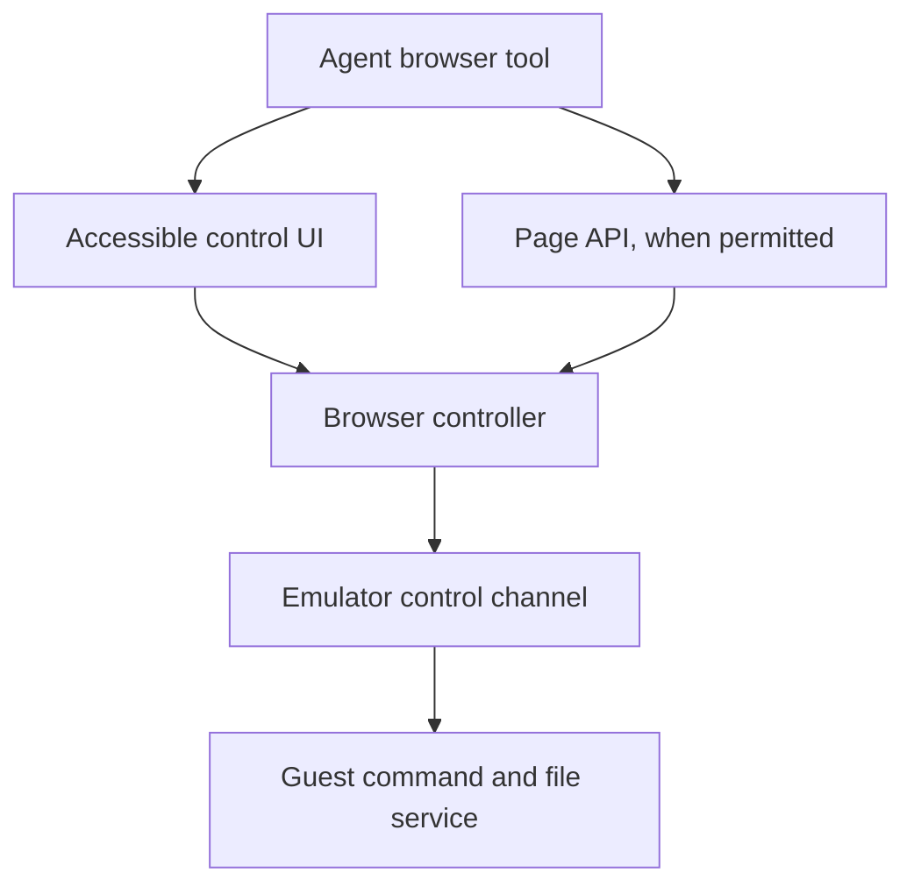

# Browser agents: a Snowglobe tab as an agent's workspace (planned, not started)

Status: kept for a later stage. Why: normal chat agents could run whatever they need from the
client's own browser, delegating compute to the visitor's browser instead of servers.

---

Enable AI agents to open a Snowglobe URL and use the Linux machine running inside that browser tab as a programmable workspace. Agents should be able to execute commands, read and write files, inspect results, cancel work, and save or restore progress through a documented interface accessible to browser automation tools.

The website delivers the runtime, filesystem and prepared machine snapshot as static assets. Computation happens inside the browser using Snowglobe’s WASM emulator, without requiring a native Snowglobe installation or an execution server. Access remains subject to browser permissions, resource limits and networking restrictions.

The implementation should add a **browser control layer over Snowglobe’s existing machine**, with a structured API and an accessible UI backed by the same operations.

The interfaces below are proposed additions. Snowglobe’s [existing agent tools](https://filipecabaco.github.io/snowglobe/docs/agents/) provide a useful model, but their documented implementation runs natively.

**1. Define a small, versioned control contract**

Expose one browser-side controller:

```ts
interface SnowglobeAgent {
  capabilities(): Promise<{
    protocolVersion: "1";
    buildId: string;
    sessionId: string;
    features: string[];
  }>;

  status(): Promise<{
    state: "loading" | "ready" | "busy" | "stopped" | "error";
  }>;

  runCommand(input: {
    command: string;
    cwd?: string;
    env?: Record<string, string>;
    timeoutMs?: number;
    requestId: string;
  }): Promise<{ jobId: string }>;

  readJob(input: {
    jobId: string;
    cursor?: string;
    maxBytes?: number;
  }): Promise<{
    state: "queued" | "running" | "finished" | "cancelled" | "failed";
    stdout: string;
    stderr: string;
    nextCursor: string;
    exitCode: number | null;
    truncated: boolean;
  }>;

  cancelJob(jobId: string): Promise<void>;

  readFile(input: {
    path: string;
    offset?: number;
    maxBytes?: number;
    encoding: "utf8" | "base64";
  }): Promise<{ data: string; nextOffset: number; eof: boolean }>;

  writeFile(input: {
    path: string;
    data: string;
    encoding: "utf8" | "base64";
  }): Promise<void>;
}
```

Return JSON-serializable values. Keep binary assets and large outputs inside the browser; transfer them in bounded chunks when needed.

Make `requestId` idempotent within a session: retrying the same request must return the original job rather than execute the command twice. Reject reuse of an ID with different arguments.

**2. Add a dedicated guest control channel**

Avoid making shell-prompt recognition the execution protocol.

The intended structure is:



Inspect Snowglobe’s existing native command and file implementation first, then reuse the guest-side mechanisms where possible.

If the browser runtime does not expose a suitable channel, add a dedicated virtual serial device or equivalent emulator-supported transport. Keep it separate from the interactive terminal.

Use framed messages containing:

```ts
type Message = {
  version: 1;
  sessionId: string;
  requestId: string;
  operation: string;
  payload: unknown;
};
```

Use length-prefixed frames, bounded message sizes and explicit responses. File bytes and command output must not be mistaken for control messages.

The guest service should:

- Launch commands with explicit working directory and environment.
- Capture stdout and stderr separately.
- Report completion and exit status.
- Read and write files without interpolating their contents into shell commands.
- Track running jobs for cancellation.

A command runs inside the guest and can change that guest. Root-level guest code can interfere with the guest service, so its responses should not be treated as independently trustworthy security attestations.

**3. Keep job execution asynchronous**

`runCommand()` should return a job ID immediately. Browser automation then polls `readJob()`.

This avoids holding a browser tool call open while compilation, package installation or tests run.

For the first version:

- Allow one running job per machine.
- Bound retained output and report truncation explicitly.
- Apply a default timeout and a maximum permitted timeout.
- Preserve completed job results until reset or explicit removal.
- Reject commands until the machine is ready.

Enforce deadlines from the browser controller as well as inside the guest. First request graceful termination; if the guest stops responding, provide a hard stop that terminates the emulator worker or workers.

**A hard stop ends the whole machine.** Surface that distinction in the result instead of claiming that only one process was cancelled.

**4. Provide a browser-tool-compatible UI**

The UI should be a first-class adapter to the controller:

| Control | Purpose |
|---|---|
| Machine status | Show loading, ready, running and errors |
| Command textbox | Enter a shell command |
| Working-directory field | Set execution location |
| Run button | Submit a job |
| Job result panel | Show job ID, status, exit code and output |
| Cancel button | Stop the selected job |
| File editor | Read and write text files |
| Import/export controls | Transfer binary files |
| Save/reset controls | Manage machine state |

Use semantic HTML, accessible labels and ordinary text output, such as `<pre>` elements. Keep the graphical terminal for interactive use, but ensure an agent can complete the basic workflow without interpreting terminal screenshots.

Where a browser integration explicitly permits page API calls, expose the controller as:

```js
window.snowglobeAgent
```

Do not assume every browser integration permits arbitrary JavaScript calls. **The visible UI must support the core workflow independently.**

**5. Integrate persistence with existing saves**

Snowglobe already documents [whole-machine browser saves and backup files](https://filipecabaco.github.io/snowglobe/docs/saving/). Reuse that machinery.

For the first version:

- Support explicit save and restore through the control UI.
- Save only while no agent job is running.
- Associate saves with the site’s build identity.
- Generate a new session ID after restore or reset.
- Invalidate previous job handles after the session changes.

Saving only between jobs simplifies consistency: restoring a machine should not accidentally resume an old command while the controller believes the machine is idle.

**6. Preserve explicit resource and network boundaries**

Publish capabilities with the site so the agent can inspect what is available:

```json
{
  "protocolVersion": "1",
  "execution": "browser-wasm",
  "architecture": "arm64",
  "workspace": "/workspace",
  "maxConcurrentJobs": 1,
  "maxCommandTimeoutMs": 300000,
  "maxOutputBytes": 1048576,
  "network": {
    "mode": "fetch",
    "corsApplies": true
  }
}
```

These values should reflect the actual build and controller configuration.

Keep Snowglobe’s [existing networking model](https://filipecabaco.github.io/snowglobe/docs/networking/): networking must be enabled, browser CORS applies, and other TCP destinations require configured tunnels.

Do not place secrets in publicly served snapshots. If exposing cross-frame messaging later, validate both the sender window and its exact origin.

**7. Implement and verify in this order**

1. **Runtime bridge:** start a command inside the browser guest and retrieve structured output and exit status.
2. **Job lifecycle:** add polling, timeout, cancellation and duplicate-request handling.
3. **Files:** support text and binary round trips, with bounded transfers.
4. **Accessible UI:** expose those operations through labelled controls.
5. **Persistence:** connect save, restore and session invalidation.
6. **Browser automation test:** complete a real coding task through the UI.

The acceptance test should be concrete:

> An agent opens a published Snowglobe URL, waits for readiness, writes `/workspace/main.py`, runs it, reads its output and exit code, modifies the file, reruns it, and exports a generated artifact—all inside the browser, without invoking native Snowglobe or an execution backend.

Also test a timed-out command, a duplicated submission, excessive output, a binary file round trip, and restoration of a saved workspace.

**The first milestone is one complete browser-driven coding loop.** Once that works reliably, the same controller can support richer tool adapters without changing how the guest executes programs.
